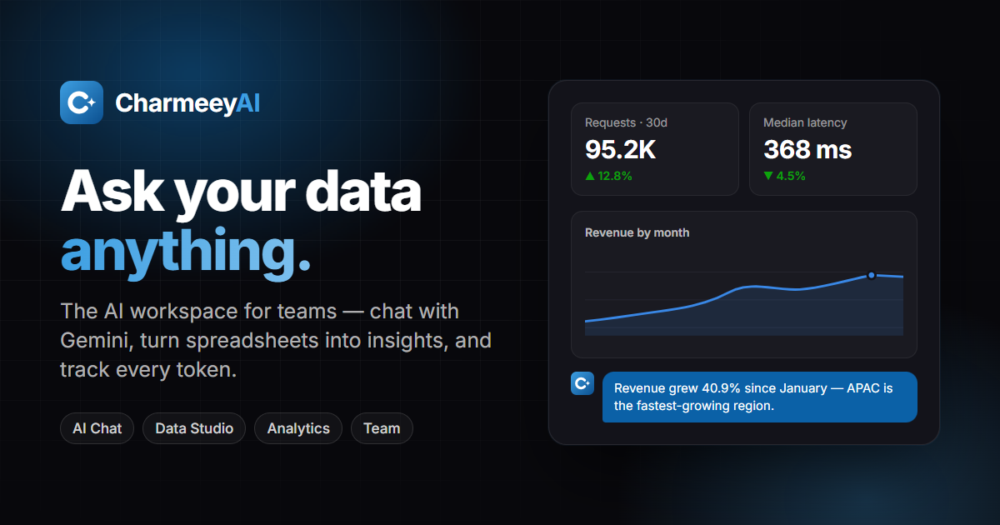

# CharmeeyAI — AI-Powered SaaS Platform

Modern, production-grade AI-powered SaaS platform combining a **React / Vite frontend**, **Prisma ORM**, **Gemini AI SDK**, and a **FastAPI Python AI microservice**.

---



---

## Features

- **AI Chat**: multimodal Gemini chat (text, voice, images, documents) with copy/export.
- **Data Studio**: upload a CSV (or use a sample dataset) to get column profiling, auto-insights (trends, correlations, outliers) and a bar/line/area/scatter chart builder, then send the findings to the AI.
- **Usage Analytics**: KPI tiles with period-over-period deltas, requests by model, latency (p50/p95), spend, feature and team usage, a chart/table toggle and CSV export.
- **Prompt Templates & History**: a searchable template library and conversation history that open straight into the chat.
- **Team Chat**: real-time room and DMs over WebSockets with notifications.
- **Auth**: sign up / sign in with PBKDF2-hashed passwords and expiring server-side sessions, plus a demo workspace.
- **SaaS admin**: an Overview home with an onboarding checklist, workspace switcher, Members (invites, roles, seat limits), API Keys & webhooks, Integrations, Billing (plans, usage meters, invoices), Audit Log (filters, CSV export), Help & Support (FAQ, tickets, status) and tabbed Settings (profile, password & 2FA, sessions, notifications, appearance, workspace).
- **Productivity**: ⌘K / Ctrl+K command palette, notifications inbox, toasts, collapsible grouped sidebar, light/dark themes.

> **Portfolio / offline mode:** if the FastAPI service is unreachable, the frontend falls back to a browser-local mock (accounts in `localStorage`, canned AI replies) and shows an "Offline demo" badge. Dashboard metrics are deterministic sample data (`apps/web/src/lib/mockData.ts`).

## Architecture

```tree
├── apps/
│   └── web/                 # React + TypeScript Vite frontend
├── packages/
│   ├── ai-sdk/              # Gemini LLM SDK types & shared helpers
│   └── database/            # Prisma ORM schema & database client
└── services/
    └── ai/                  # FastAPI Python microservice (Auth, Gemini chat, embeddings)
```

## Quick Start

### Prerequisites

- Node.js (v18+)
- Python 3.10+
- Docker & Docker Compose (optional, for local PostgreSQL/Redis/MinIO)

### 1. Install Dependencies

```bash
npm install
```

### 2. Run with Docker (Recommended)

```bash
# Start infrastructure (PostgreSQL, Redis, MinIO)
npm run docker:up

# Start frontend development server
npm run dev:web
```

Open [http://localhost:5173](http://localhost:5173).

### 3. Run Locally (Without Docker)

- **Database & Python Service:**
  Ensure PostgreSQL is running and `.env` has your `DATABASE_URL`.

  ```bash
  npx prisma generate --schema=packages/database/prisma/schema.prisma

  cd services/ai
  pip install -r requirements.txt
  uvicorn app.main:app --reload --port 8000
  ```

- **Frontend:**
  ```bash
  npm run dev:web
  ```

---

## Workspace Scripts

- `npm run dev:web` — Start frontend dev server
- `npm run build:web` — Build frontend for production
- `npm run lint:web` — Run ESLint
- `npm run typecheck:web` — Run TypeScript type checking
- `npm run docker:up` / `docker:down` — Manage Docker infrastructure

---

## GitHub Guide & Contribution

1. **Clone the repository:**

   ```bash
   git clone https://github.com/charmeey/Charmeey_AI-SaaS_FullStack.git
   cd Charmeey_AI-SaaS_FullStack
   ```

2. **Create a feature branch:**

   ```bash
   git checkout -b feature/your-feature-name
   ```

3. **Commit your changes:**

   ```bash
   git add .
   git commit -m "feat: description of your feature"
   ```

4. **Push to GitHub and open a Pull Request:**
   ```bash
   git push origin feature/your-feature-name
   ```
   Navigate to [GitHub Repository](https://github.com/charmeey/Charmeey_AI-SaaS_FullStack) to open a Pull Request.

---

## License

MIT
